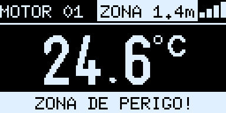
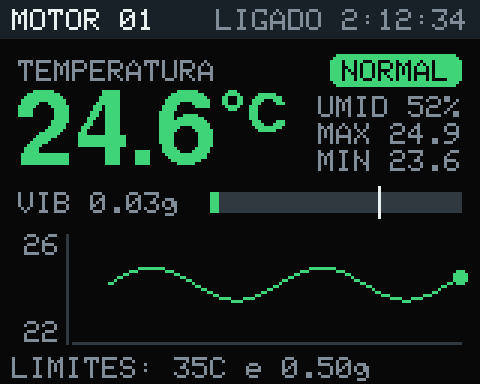
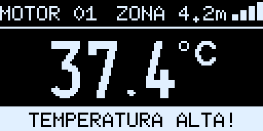
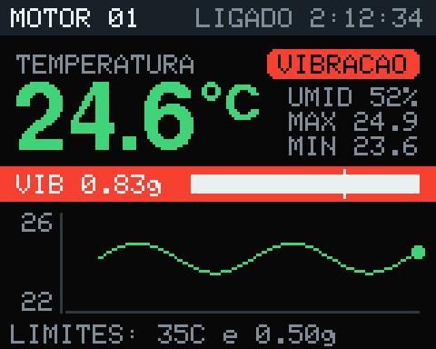
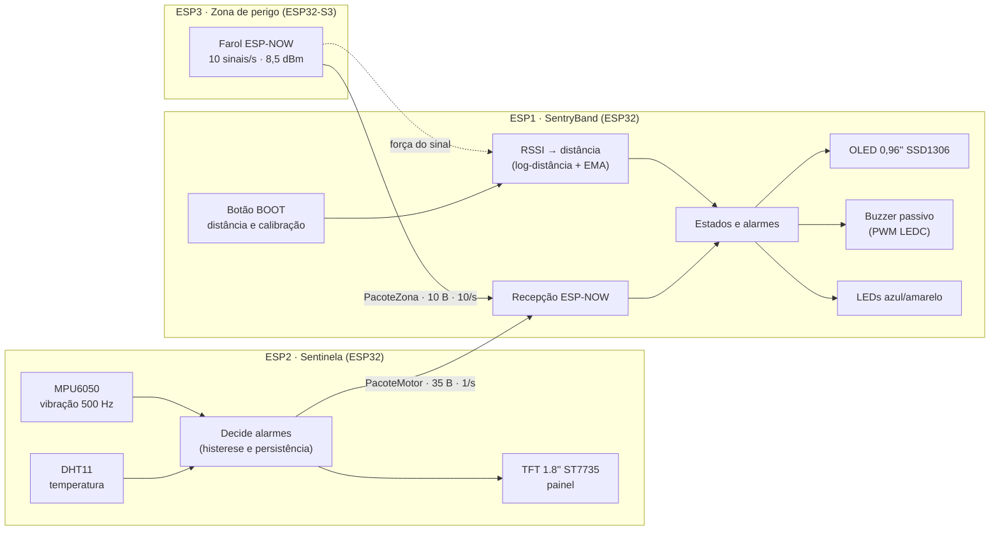

# SentryBand: pulseira de segurança industrial com ESP32

Sistema de segurança do trabalho com três ESP32 que conversam por rádio (ESP-NOW), feito para o **Ideathon da Trilha da Inovação do Sebrae em parceria com a ArcelorMittal**. A **SentryBand**, pulseira do trabalhador, avisa com bipes, luzes e tela quando ele entra numa **zona de perigo**. O **Sentinela**, instalado na máquina, detecta quando ela **esquenta demais** (indício de incêndio) ou **vibra de forma anormal** (indício de acidente) e manda o alerta para a pulseira.


| SentryBand (OLED) | Sentinela (TFT) |
|---|---|
|  |  |
|  |  |

*Imagens geradas a partir do próprio firmware, pixel a pixel (veja [Verificação e testes](docs/verificacao-e-testes.md)).*

## Sumário

- [O desafio](#o-desafio)
- [A solução](#a-solução)
- [Arquitetura](#arquitetura)
- [Hardware e ligações](#hardware-e-ligações)
- [Como funciona](#como-funciona)
- [Destaques técnicos](#destaques-técnicos)
- [Como gravar](#como-gravar)
- [Testes](#testes)
- [Estrutura do repositório](#estrutura-do-repositório)
- [Limitações e próximos passos](#limitações-e-próximos-passos)
- [Créditos](#créditos)

## O desafio

No Ideathon, o Sebrae e a ArcelorMittal apresentaram vários problemas reais da indústria. A equipe escolheu a **segurança do trabalho** e três riscos comuns em plantas industriais:

1. **Áreas perigosas:** trabalhadores que entram, sem perceber, perto de trituradores, prensas, tratores ou guindastes em operação.
2. **Incêndio:** superaquecimento de motores e equipamentos.
3. **Acidentes com máquinas:** impacto contra um motor, uma hélice ou uma peça em movimento.

## A solução

| Risco | Como o sistema detecta | Como avisa |
|---|---|---|
| Entrar numa área perigosa | Um farol de rádio (ESP3) marca o centro da área; a pulseira mede a força do sinal e calcula a distância | 5 bipes rápidos e agudos, "ZONA DE PERIGO!" e LED amarelo piscando |
| Incêndio ou superaquecimento | Sensor de temperatura DHT11 na máquina, com alarme a partir de 35 °C | 3 bipes curtos, "TEMPERATURA ALTA!" e painel piscando em vermelho |
| Acidente com a máquina | Acelerômetro MPU6050 preso à máquina mede a vibração (RMS); alarme com 0,50 g por 2 s seguidos | 2 bipes longos, "VIBRACAO ALTA!" e linha de vibração piscando |

Com tudo normal, o LED azul da pulseira fica aceso. Se algum sensor falhar ou a máquina sair do ar, o amarelo pisca devagar.

## Arquitetura



| Placa | Papel |
|---|---|
| **ESP1 – SentryBand** (pulseira) | Fica com o trabalhador. Recebe os dados da máquina, mede a distância até a zona de perigo e avisa com bipes, LEDs e tela. |
| **ESP2 – Sentinela** (máquina) | Fica na máquina. Lê temperatura e vibração, **decide os alarmes** e transmite a cada segundo. Mostra tudo numa TFT colorida. |
| **ESP3 – Zona** | Fica no centro da área perigosa. É só um farol de rádio: não tem nenhum fio, só alimentação USB. |

A comunicação é por **ESP-NOW em broadcast no canal 1**: sem roteador, sem internet e com latência de milissegundos. Formato byte a byte das mensagens em [docs/protocolo-esp-now.md](docs/protocolo-esp-now.md).

## Hardware e ligações

| Placa | Componentes |
|---|---|
| ESP1 – SentryBand | ESP32 DevKit (ESP-32S) · OLED 0,96" SSD1306 I2C · buzzer passivo KY-006 · 2 filamentos de LED 3 V (azul e amarelo) |
| ESP2 – Sentinela | ESP32 DevKit · DHT11 (KY-015) · MPU6050 (GY-521) · TFT 1.8" ST7735 SPI |
| ESP3 – Zona | ESP32-S3 mini (sem componentes externos) |

| ESP | Módulo | Pino do módulo | Liga no pino |
|---|---|---|---|
| **ESP1 (SentryBand)** | Tela OLED 0,96" | VCC / GND | 3V3 / GND |
| | | SCL / SDA | GPIO 22 / GPIO 21 |
| | Buzzer passivo KY-006 | S / meio / − | GPIO 32 / não liga / GND |
| | Filamento de LED azul | + / − | GPIO 25 / GND |
| | Filamento de LED amarelo | + / − | GPIO 26 / GND |
| **ESP2 (Sentinela)** | DHT11 (KY-015) | S / meio (+) / − | GPIO 4 / 3V3 / GND |
| | Tela TFT 1.8" (ST7735) | VCC / GND / LED | 3V3 / GND / 3V3 |
| | | CS / RESET / A0 | GPIO 5 / GPIO 22 / GPIO 21 |
| | | SDA (MOSI) / SCK | GPIO 23 / GPIO 18 |
| | MPU6050 (GY-521) | VCC / GND | 3V3 / GND |
| | | SCL / SDA | GPIO 32 / GPIO 33 |
| | | XDA, XCL, AD0, INT | não liga |
| **ESP3 (zona)** | – | – | nenhum fio, só USB |

Todos os módulos são alimentados no **3V3**, e nenhum fio vai no 5V. Lista de materiais, mapa de pinos e cuidados elétricos em [docs/hardware-e-ligacoes.md](docs/hardware-e-ligacoes.md).

## Como funciona

**Temperatura (Sentinela).**
- O DHT11 é lido a cada 2 s.
- O alarme liga em 35 °C e só desliga em 34 °C (histerese).
- Falhas isoladas do sensor repetem a última leitura boa; o erro só é declarado depois de 3 falhas seguidas.

**Vibração (Sentinela).**
- O MPU6050 é lido direto pelos registradores, a 500 Hz, com escala de ±4 g e filtro de 184 Hz.
- A cada segundo, a vibração é o **RMS da aceleração sem a gravidade**: a raiz da soma das variâncias dos três eixos, calculadas com somas inteiras de 64 bits. O resultado não depende da posição em que o sensor foi colado.
- O alarme exige 2 s seguidos acima de 0,50 g, para uma batida isolada não disparar.

**Zona de perigo (SentryBand + farol).**
- A pulseira mede a força (RSSI) dos sinais do farol e converte em distância pelo modelo log-distância:
  $\text{RSSI}(d) = \text{RSSI}_{1m} - 10\,n\,\log_{10}(d)$, com $n = 2{,}5$.
- A média é recalculada a cada 200 ms, com pesos diferentes para o sinal que sobe (0,5) e para o que desce (0,3). Assim ela avisa rápido quando a pessoa chega e não fica liga-desliga na borda.
- Pelo botão BOOT, o trabalhador escolhe a distância (1, 2, 3 ou 5 m) e calibra a borda parado nela. Os valores ficam gravados na memória flash (NVS).

**SentryBand (ESP1).**
- Uma máquina de estados combina os alarmes da máquina (só se os dados tiverem menos de 10 s) com a zona de perigo, que funciona mesmo sem a máquina.
- Cada alarme tem o seu padrão de bipe, e com mais de um ativo eles se revezam.

Explicação completa, com as fórmulas e o motivo de cada escolha, em [docs/algoritmos.md](docs/algoritmos.md).

## Destaques técnicos

- **Farol de ESP-NOW no lugar de um roteador Wi-Fi:** a pulseira mede a distância sem fazer busca de redes, que a deixaria surda para a máquina por 1–2 s.
- **Suavização do RSSI escolhida com dados:** 8 configurações comparadas em simulação, com 20 caminhadas cada. A escolhida avisa, em média, a 1,7 m de uma zona de 2 m para quem anda a 1 m/s; a configuração inicial avisava a 1,0 m.
- **Calibração na borda:** a pulseira grava o $\text{RSSI}_{1m}$ que faz a borda cair exatamente onde a pessoa está, usando a média dos 3 s com o botão apertado.
- **MPU6050 sem biblioteca:** leitura direta dos registradores, compatível com os clones que a biblioteca comum recusa. Busca o sensor de novo sozinho se o fio soltar.
- **Recuperação do barramento I2C:** até 9 pulsos no SCL e uma condição de STOP antes de iniciar. O core do ESP32 não faz isso no modo mestre, e a falta disso travou a OLED numa regravação.
- **Buzzer passivo por PWM** (periférico LEDC), com padrões e tons diferentes por alarme e máquina de estados sem `delay()`.
- **LEDs de 100 mA sem resistor nem transistor:** a força de saída do pino foi limitada (`gpio_set_drive_capability`) depois de medir a tensão dos filamentos com o próprio conversor analógico do ESP32.
- **TFT sem tremer:** desenho num *buffer* de 40 KB (`GFXcanvas16`) e envio de uma vez, com gráfico de 15 minutos de escala automática e linha do limite.
- **Protocolo versionado:** separação das mensagens pelo tamanho, assinatura e versão; trava `portMUX` entre a tarefa do Wi-Fi e o `loop()`; detecção de dados velhos.
- **Tudo verificado no PC:** os alarmes são decididos num lugar só (a máquina), e a lógica dos três firmwares foi portada para Python e testada. As telas foram desenhadas pixel a pixel com as fontes reais das bibliotecas.

## Como gravar

| Pasta | Placa no Arduino IDE | Bibliotecas |
|---|---|---|
| [`esp1_pulseira/`](esp1_pulseira/esp1_pulseira.ino) | ESP32 Dev Module | U8g2 |
| [`esp2_motor/`](esp2_motor/esp2_motor.ino) | ESP32 Dev Module | DHT sensor library, Adafruit Unified Sensor, Adafruit GFX, Adafruit ST7735 and ST7789 |
| [`esp3_zona/`](esp3_zona/esp3_zona.ino) | ESP32S3 Dev Module (*USB CDC On Boot: Enabled*) | nenhuma |

Pacote de placas **esp32 by Espressif Systems 3.x** (usado: 3.3.12). Passo a passo, uso da pulseira, calibração da zona e problemas comuns em [docs/guia-de-uso.md](docs/guia-de-uso.md).

## Testes

| Nível | Resultado |
|---|---|
| Compilação com `--warnings all` | os 3 firmwares sem nenhum aviso |
| Simulação da lógica ([`ferramentas/simular.py`](ferramentas/simular.py)) | 46 de 46 verificações |
| Ajuste da zona ([`ferramentas/ajuste_zona.py`](ferramentas/ajuste_zona.py)) | tabela com 8 configurações × 20 caminhadas |
| Telas ([`ferramentas/telas.py`](ferramentas/telas.py)) | 12 telas desenhadas pixel a pixel |
| Hardware | comunicação sem perdas na bancada, alarmes de temperatura e vibração, zona de perigo e LEDs testados nas placas; sistema apresentado ao vivo no Ideathon |

Detalhes, a saída completa da simulação, os diagnósticos de hardware e os problemas encontrados no caminho em [docs/verificacao-e-testes.md](docs/verificacao-e-testes.md).

## Estrutura do repositório

```
├── esp1_pulseira/esp1_pulseira.ino   ESP1 – SentryBand: recepção, zona, alarmes, OLED, buzzer, LEDs
├── esp2_motor/esp2_motor.ino         ESP2 – Sentinela: DHT11, MPU6050, decisão dos alarmes, TFT
├── esp3_zona/esp3_zona.ino           ESP3 – farol da zona de perigo
├── docs/
│   ├── hardware-e-ligacoes.md        materiais, onde vai cada fio, mapa de pinos
│   ├── protocolo-esp-now.md          mensagens byte a byte, recepção, versões, segurança
│   ├── algoritmos.md                 temperatura, vibração, zona, estados, bipes, LEDs, telas
│   ├── verificacao-e-testes.md       compilação, simulação, ajuste, diagnósticos, resultados
│   ├── guia-de-uso.md                gravação, operação, calibração, problemas comuns
│   └── imagens/                      telas geradas a partir do firmware
└── ferramentas/                      simulação, ajuste da zona e desenho das telas (Python)
```

## Limitações e próximos passos

- **Distância aproximada:** a medida por força do sinal sofre com reflexões, com o corpo do trabalhador e com a orientação das antenas. Rádios **UWB** (DW1000/DW3000) dariam precisão de centímetros.
- **DHT11:** mede de 0 a 50 °C, com erro de ±2 °C, e só o ar em volta da máquina. Para detectar incêndio de verdade, o caminho seria um termopar ou sensor infravermelho (MLX90614) somado a um sensor de fumaça ou gás.
- **Limite de vibração:** precisa ser calibrado para cada máquina.
- **Segurança do rádio:** as mensagens não têm criptografia nem autenticação. Uma versão real usaria a criptografia nativa do ESP-NOW ou uma assinatura HMAC com contador.
- **Pulseira vestível:** bateria LiPo com carregador e uma placa menor, como um ESP32-C3 ou S3 mini.
- **Escala:** várias zonas e várias pulseiras (os IDs já existem nas mensagens) e uma central que registre os eventos.

## Créditos

Projeto desenvolvido por **Lucas Noberto** para o Ideathon da **Trilha da Inovação** — **Sebrae** em parceria com a **ArcelorMittal**.
