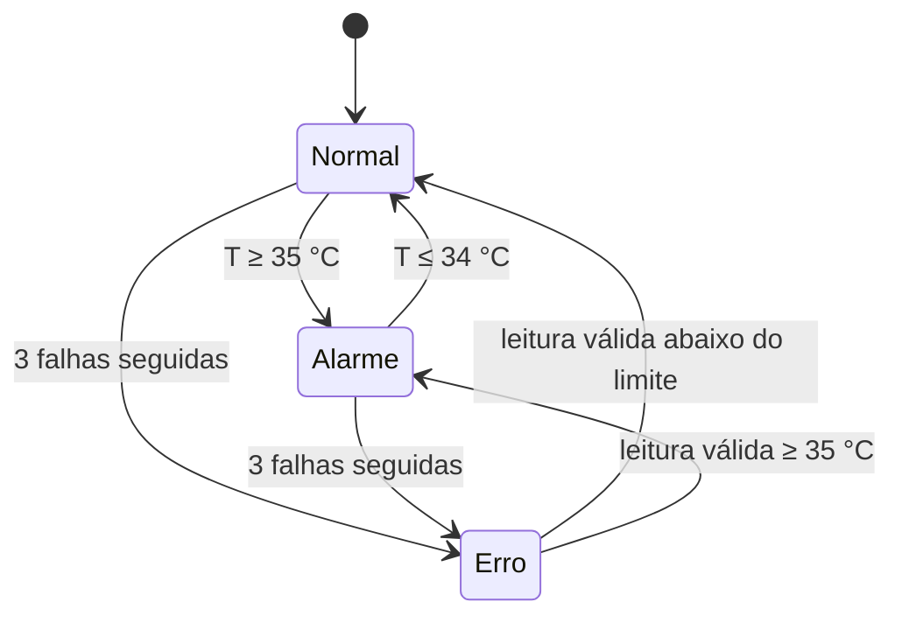
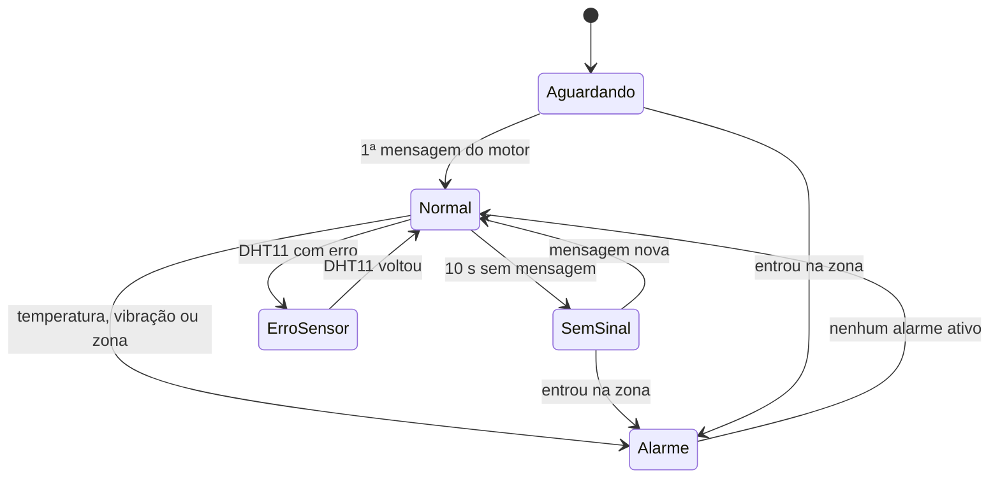

# Algoritmos e técnicas

Este documento explica como cada firmware funciona por dentro e o motivo de cada escolha. Os valores citados são os do código atual. Nomes usados no projeto: a pulseira é a **SentryBand** (ESP1) e o dispositivo da máquina, que detecta incêndio e vibração, é o **Sentinela** (ESP2).

## Sumário

1. [Estrutura dos firmwares](#estrutura-dos-firmwares)
2. [Temperatura e detecção de incêndio (ESP2)](#temperatura-e-detecção-de-incêndio-esp2)
3. [Vibração e detecção de acidentes (ESP2)](#vibração-e-detecção-de-acidentes-esp2)
4. [Zona de perigo por força do sinal (ESP1 + ESP3)](#zona-de-perigo-por-força-do-sinal-esp1--esp3)
5. [Estados e alarmes da pulseira (ESP1)](#estados-e-alarmes-da-pulseira-esp1)
6. [Bipes com buzzer passivo](#bipes-com-buzzer-passivo)
7. [LEDs de situação](#leds-de-situação)
8. [Telas](#telas)
9. [Robustez](#robustez)

## Estrutura dos firmwares

Os três firmwares são escritos para o Arduino core do ESP32 (versão 3.x, baseado no ESP-IDF 5) e seguem a mesma regra: **nada trava o `loop()`**. Cada tarefa tem o seu relógio, baseado em `millis()` ou `micros()`, e as diferenças de tempo são calculadas em `uint32_t`/`int32_t`, o que continua certo quando o contador dá a volta, depois de 49,7 dias ligado.

| Firmware | Ritmo do `loop()` |
|---|---|
| **ESP2 – Sentinela** | acelerômetro a cada 2 ms · DHT11 a cada 2 s · a cada 1 s fecha a janela de vibração, decide os alarmes e envia · redesenha a TFT a cada segundo, a cada dado novo e a cada 0,5 s quando há alarme piscando · um ponto no gráfico a cada 7 s |
| **ESP1 – SentryBand** | processa a mensagem do motor assim que chega · decide a zona a cada 200 ms · lê o botão · máquina de estados e bipes · LEDs · redesenha a OLED a cada 0,5 s ou quando algo muda · pausa de 2 ms por volta |
| **ESP3 – zona** | envia um farol a cada 100 ms e um resumo no Monitor Serial a cada 5 s |

## Temperatura e detecção de incêndio (ESP2)

O DHT11 fica perto da máquina e mede a temperatura do ar. Uma subida anormal indica superaquecimento ou início de incêndio.

**Leitura.** O DHT11 só faz uma medida nova a cada 2 s, então o firmware lê nesse ritmo (`readTemperature(false, true)` força a medida, e a umidade sai da mesma leitura). Cada leitura segura o `loop()` por uns 25 ms (20 ms de sinal de início e uns 5 ms de transferência no protocolo de 1 fio do sensor). As outras tarefas do ESP32, como o Wi-Fi, continuam rodando nesse tempo.

**Tolerância a falhas.** Falhas isoladas são comuns no DHT11. Por isso:
- numa falha, o firmware repete a última leitura boa;
- só depois de **3 falhas seguidas** (`FALHAS_ATE_ERRO`) o sensor é dado como com erro: `sensorOk = 0`, temperatura `NAN`, o alarme sai e a tela mostra "ERRO SENSOR";
- a primeira mensagem para a pulseira só sai depois da primeira leitura válida (ou das 3 falhas), para não mostrar um erro falso na partida.

**Alarme com histerese.** Liga em $T \ge 35{,}0\,°C$ (`LIMITE_ALARME`) e só desliga em $T \le 34{,}0\,°C$ (`LIMITE_ALARME − HISTERESE`). Entre os dois valores, o estado anterior é mantido. Isso evita que o alarme fique ligando e desligando quando a temperatura oscila em volta do limite, já que o DHT11 tem resolução de 1 °C e erro de ±2 °C.



O limite foi mudado várias vezes durante o projeto (46 °C → 35 °C → 28 °C para a apresentação, numa sala fria → 35 °C). Como o alarme é decidido só no ESP2, a mudança é uma linha num arquivo só.

## Vibração e detecção de acidentes (ESP2)

Se um trabalhador bate num motor, numa hélice ou numa peça em movimento, a estrutura vibra de forma anormal. O MPU6050 preso à máquina mede essa vibração.

### Leitura direta dos registradores

O MPU6050 é lido pelo I2C a 400 kHz, **sem biblioteca**. A biblioteca mais comum confere o registrador `WHO_AM_I` e recusa muitos clones vendidos como MPU6050, que respondem com outro valor. O firmware só verifica se há resposta nos endereços 0x68 ou 0x69 e configura o sensor:

| Registrador | Endereço | Valor | Efeito |
|---|---|---|---|
| `PWR_MGMT_1` | 0x6B | 0x01 | Acorda o sensor e usa o PLL do giroscópio X como relógio (mais estável) |
| `SMPLRT_DIV` | 0x19 | 0x00 | 1000 medidas por segundo (com o filtro ligado) |
| `CONFIG` | 0x1A | 0x01 | Filtro passa-baixa digital de 184 Hz |
| `ACCEL_CONFIG` | 0x1C | 0x08 | Escala de ±4 g (8192 contagens = 1 g) |

A leitura pede 6 bytes a partir de `ACCEL_XOUT_H` (0x3B), com *repeated start*, e monta X, Y e Z em big-endian. Os bytes são lidos primeiro para um vetor e só depois combinados, porque em C++ a ordem de avaliação de `(Wire.read() << 8) | Wire.read()` não é garantida.

A escala de ±4 g dá folga para batidas fortes sem saturar. O filtro de 184 Hz deixa passar a vibração de motores comuns (rotação de 1500 a 3600 rpm = 25 a 60 Hz, mais harmônicos).

### Vibração como RMS da aceleração dinâmica

O acelerômetro sempre mede a gravidade (1 g) somada à vibração, e a gravidade aparece em eixos diferentes conforme a posição em que o sensor foi colado. A solução é medir **o quanto a aceleração varia em volta da sua média**: a média de cada eixo no intervalo é a gravidade, e a variação é a vibração. Assim o resultado não depende da posição do sensor.

O firmware lê o acelerômetro a cada 2 ms (500 vezes por segundo) e acumula, para cada eixo, a soma e a soma dos quadrados das leituras brutas:

- soma em `int32_t` (até 500 × 32 768 = 16,4 milhões);
- soma dos quadrados em `int64_t` (até 5,4 × 10¹¹), sem erro de arredondamento.

A cada 1 s, com $n$ leituras:

$$\sigma_x^2 = \frac{\sum x_i^2}{n} - \left(\frac{\sum x_i}{n}\right)^2 \qquad\qquad \text{vibração} = \frac{\sqrt{\sigma_x^2 + \sigma_y^2 + \sigma_z^2}}{8192}\ \text{g}$$

Isso é o valor RMS do vetor de aceleração sem a gravidade. Para uma vibração senoidal de amplitude $A$, o resultado é $A/\sqrt{2}$, como a simulação confirma (0,3 g de pico → 0,212 g).

As leituras são cadenciadas por `micros()`. Durante o redesenho da TFT (~30 ms) e a leitura do DHT11 (~25 ms), algumas medidas não acontecem. Isso não distorce o RMS, porque a vibração é praticamente constante dentro de um segundo; a simulação inclui essa lacuna de propósito. A janela só é aceita com pelo menos 100 leituras; com menos, o sensor é considerado desconectado.

### Alarme com persistência

| Condição | Ação |
|---|---|
| vibração ≥ 0,50 g por **2 janelas seguidas** (2 s) | liga o alarme |
| vibração < 0,40 g (80% do limite) por **3 janelas seguidas** | desliga o alarme |
| entre 0,40 e 0,50 g | mantém o estado anterior |

A exigência de 2 s seguidos impede que uma batida isolada (alguém encostando na máquina) dispare o alarme. O limite de 0,50 g é um ponto de partida: o certo é medir a vibração da máquina funcionando normal (aparece na TFT) e usar 2 a 3 vezes esse valor.

### Recuperação automática

- **Sensor sumiu:** se uma janela não tem leituras suficientes, o firmware tenta encontrar o MPU6050 de novo a cada 5 s. Um fio que solta e volta, ou um sensor ligado depois, é reconhecido sem reiniciar a placa. Uma leitura que falha também pausa as tentativas por 100 ms, para o `loop()` não ficar preso em erros de I2C.
- **Barramento I2C travado:** se o ESP32 reinicia no meio de uma leitura, o MPU6050 pode ficar segurando a linha SDA em nível baixo, esperando pulsos de relógio que nunca chegam. O core 3.3.12 do ESP32 não destrava o I2C mestre sozinho. Por isso, antes de iniciar o barramento, o firmware:
  1. lê SDA e SCL com o pull-down interno ligado. Com o módulo alimentado, os resistores dele puxam as duas linhas para nível alto;
  2. se o SCL está baixo, avisa "módulo sem energia ou fio solto";
  3. se só o SDA está baixo, gera até 9 pulsos no SCL (em modo *open-drain*) até o escravo soltar o SDA, e termina com uma condição de STOP.

  A mesma rotina protege a OLED da pulseira.

## Zona de perigo por força do sinal (ESP1 + ESP3)

O objetivo é impedir que um trabalhador entre, sem perceber, numa área perigosa: perto de trituradores, tratores, guindastes, prensas. O ESP3 fica no centro da área e a pulseira mede o quanto ela está perto.

### Medida: RSSI do farol

O ESP3 manda um `PacoteZona` a cada 100 ms com potência fixa de 8,5 dBm. A pulseira lê a força com que cada quadro chegou (RSSI, em dBm): quanto mais forte, mais perto.

### Modelo de propagação

A força do sinal cai com o logaritmo da distância (modelo log-distância):

$$\text{RSSI}(d) = \text{RSSI}_{1\,m} - 10\,n\,\log_{10}(d)$$

- $\text{RSSI}_{1\,m}$: força a 1 m (−60 dBm antes de calibrar; depois vem da calibração);
- $n = 2{,}5$: expoente do ambiente (2 = campo aberto, 3 = muitos obstáculos).

Para uma zona de raio $D$, a borda fica em:

$$\text{RSSI}_{borda} = \text{RSSI}_{1\,m} - 25\,\log_{10}(D)$$

A distância mostrada na OLED é o modelo invertido:

$$d = 10^{\,(\text{RSSI}_{1\,m} - \text{RSSI})\,/\,(10\,n)}$$

### Suavização

O RSSI de cada quadro varia vários dB por causa de reflexões. O firmware:

1. soma os RSSI recebidos (dentro da trava, porque chegam pela tarefa do Wi-Fi);
2. a cada **200 ms**, tira a média dos quadros recebidos no período (cerca de 2);
3. aplica uma média móvel exponencial **assimétrica**: peso **0,5 quando o sinal sobe** (pessoa chegando) e **0,3 quando desce** (pessoa saindo).

A assimetria privilegia a segurança: entrar na zona é detectado rápido, e sair exige um sinal mais fraco por mais tempo. Esses números saíram de uma comparação de 8 configurações em simulação, com 20 caminhadas e ruído de 3 dB cada (tabela completa em [verificacao-e-testes.md](verificacao-e-testes.md#ajuste-da-zona-de-perigo)). Com a configuração original (média a cada 500 ms, pesos iguais), uma pessoa andando a 1 m/s só era avisada a 1,0 m de uma zona de 2 m. Com a escolhida, é avisada em média a 1,7 m, e sem liga-desliga parada na borda.

### Histerese e perda do farol

- **Entra** na zona quando $\text{RSSI} \ge \text{RSSI}_{borda}$.
- **Sai** quando $\text{RSSI} < \text{RSSI}_{borda} - 3\ \text{dB}$. Com $n = 2{,}5$, 3 dB equivalem a se afastar 32% além da borda ($10^{3/25} = 1{,}32$).
- Sem nenhum farol por **3 s**, a zona é considerada fora de alcance e o alarme de zona desliga.

### Calibração e escolha da distância pelo botão BOOT

O botão BOOT da pulseira (GPIO 0) é lido depois do boot como entrada com pull-up:

| Ação | Efeito |
|---|---|
| toque rápido (de 50 ms a 3 s) | troca a distância: 1 → 2 → 3 → 5 m → 1 m |
| segurar 3 s | calibra a borda no lugar onde a pessoa está |

Na calibração, a pessoa escolhe a distância, para exatamente nela, de frente para o ESP3, e segura o botão. Durante os 3 s, a pulseira acumula as médias de RSSI de cada período e então calcula:

$$\text{RSSI}_{1\,m} = \overline{\text{RSSI}}_{\text{botão apertado}} + 10\,n\,\log_{10}(D)$$

Em outras palavras, ela grava o $\text{RSSI}_{1\,m}$ que faz a borda cair exatamente onde a pessoa está. Usar a média dos 3 s, e não um valor só, reduz o efeito das reflexões, que mudam a força do sinal a cada poucos centímetros; por isso a orientação é mexer a pulseira devagar enquanto segura.

A distância e a calibração ficam gravadas na memória flash pela biblioteca `Preferences` (NVS, *namespace* `zona`, chaves `dist` e `rssi1m`) e sobrevivem a desligar e até a regravar o firmware.

### Limitações

A distância por RSSI é **aproximada**. Reflexões no metal das máquinas, o corpo de quem usa a pulseira (a água absorve 2,4 GHz) e a orientação das antenas mudam o sinal. Na simulação, com a borda calibrada em 2 m e chegando devagar, o alarme disparou em média a 2,25 m (de 1,7 a 2,9 m). Para precisão de centímetros, o caminho seria rádio UWB, como os módulos DW1000 e DW3000, que medem o tempo de voo. O FTM do Wi-Fi não serve aqui, porque o ESP32 clássico da pulseira não o suporta.

## Estados e alarmes da pulseira (ESP1)



A cada volta do `loop()`:

1. **Alarmes do motor só valem com dados frescos:** `alarmeTempAtivo` e `alarmeVibAtivo` exigem uma mensagem recebida há no máximo 10 s. Um alarme não fica "preso" se a máquina desligar.
2. **A zona é independente:** funciona com a máquina sem sinal ou antes da primeira mensagem.
3. **Prioridade:** qualquer alarme → `ALARME`; senão, sem mensagem → `AGUARDANDO`; mensagem velha → `SEM SINAL`; DHT11 com erro → `ERRO SENSOR`; senão `NORMAL`.
4. **Ao sair do alarme**, o buzzer é calado na hora, mesmo no meio de um bipe.

## Bipes com buzzer passivo

Um buzzer passivo não toca com tensão contínua: ele precisa receber uma onda quadrada na frequência do som. O firmware usa o periférico **LEDC** (PWM) do ESP32:

```cpp
ledcAttach(PINO_BUZZER, FREQ_BIP, 10);   // canal PWM de 10 bits no GPIO 32
ledcWriteTone(PINO_BUZZER, 2500);        // liga: onda quadrada de 2500 Hz, 50% de ciclo
ledcWriteTone(PINO_BUZZER, 0);           // desliga
```

Os bipes são uma máquina de estados sem `delay()` (`bipar()` / `atualizarBuzzer()`), então a pulseira continua recebendo e decidindo enquanto apita. Cada alarme tem o seu padrão, para dar para saber qual é sem olhar a tela:

| Alarme | Padrão | Tom |
|---|---|---|
| Temperatura alta | 3 bipes de 120 ms (pausas de 90 ms) | 2500 Hz |
| Vibração alta | 2 bipes de 350 ms (pausas de 150 ms) | 2500 Hz |
| Zona de perigo | 5 bipes de 60 ms (pausas de 60 ms) | 3500 Hz, mais agudo |
| Ligou a pulseira | 1 bipe de 120 ms | 2500 Hz |

Entre uma série e outra há 700 ms de pausa. Com mais de um alarme ativo, as séries entram em **rodízio** (temperatura → vibração → zona), cada uma na sua vez.

## LEDs de situação

Os LEDs são filamentos de 3 V para 100 mA, mas um pino do ESP32 só deve fornecer uns 20 mA. Em vez de transistor e resistor, o firmware usa a **força de saída configurável** dos pinos do ESP32:

```cpp
gpio_set_drive_capability((gpio_num_t)pino, GPIO_DRIVE_CAP_2);
```

Com uma força de saída menor, a saída do pino passa a ter uma resistência interna maior, de algumas dezenas de ohms. Ligado direto ao LED, o pino estabiliza perto da tensão do LED, e a corrente fica limitada pela diferença entre 3,3 V e essa tensão. Com filamentos de nitreto de gálio e índio (InGaN, ~2,8 V), isso dá **uns 15 mA**: um brilho de LED de sinalização forte, sem forçar o pino. Na força máxima (`CAP_3`), seriam uns 25 mA, cerca de 60% mais brilho, mas sem margem de segurança.

Antes de escolher a força, um diagnóstico mediu os pinos com o conversor analógico e os resistores internos do ESP32 (veja [verificacao-e-testes.md](verificacao-e-testes.md#4-diagnósticos-de-hardware)). Ele confirmou que os dois filamentos estavam com o + no pino e o − no GND, e que ambos são de InGaN (~2,45 V a ~19 µA). Um LED amarelo "puro", de AlInGaP, teria ~1,8 V e precisaria de uma força menor.

| Situação | Azul (GPIO 25) | Amarelo (GPIO 26) |
|---|---|---|
| Tudo perfeito | aceso | apagado |
| Temperatura alta, vibração alta ou dentro da zona | apagado | pisca 2 vezes por segundo |
| Máquina sem sinal, DHT11 com erro ou MPU6050 sem resposta | apagado | pisca 1 vez por segundo |
| Ligou a pulseira | aceso 0,5 s | aceso 0,5 s (teste da ligação) |

## Telas

### TFT da máquina (ST7735, 160×128)

- **Sem tremer:** a tela inteira é desenhada num *buffer* fora da tela (`GFXcanvas16`, 40 KB de RAM) e enviada de uma vez com `drawRGBBitmap()` pelo SPI. A tela nunca mostra um desenho pela metade.
- **Layout:**
  - barra de cima com o número da máquina e o tempo ligado;
  - bloco da temperatura com número grande (FreeSansBold 18 pt), selo de situação (NORMAL, TEMP ALTA, VIBRACAO, TEMP+VIB, ERRO SENSOR) e umidade, máxima e mínima à direita. Todo o bloco pisca em vermelho no alarme de temperatura;
  - linha da vibração com o valor em g e uma barra cuja escala cheia é 1,5 vez o limite, com um tracinho branco no limite. A linha pisca em vermelho no alarme de vibração;
  - gráfico dos últimos 15 minutos: 128 pontos, um a cada 7 s, um por pixel. A escala se ajusta sozinha (em graus inteiros, com faixa mínima de 4 °C) e uma linha vermelha tracejada marca o limite quando ele está dentro da escala. Falhas do sensor viram buracos no gráfico;
  - rodapé com os limites em uso, ou "ERRO NO RADIO" se o envio falhar.
- **Quando redesenha:** a cada dado novo, a cada segundo (relógio de "ligado") e a cada 0,5 s quando há alarme piscando.

### OLED da pulseira (SSD1306, 128×64)

- Biblioteca **U8g2** com *buffer* completo (1 KB) e I2C de hardware a 400 kHz. O endereço é detectado sozinho, entre 0x3C e 0x3D.
- **Layout:**
  - cabeçalho com o número da máquina, a distância estimada até a zona (invertida quando está dentro) e quatro barrinhas com a força do sinal da máquina;
  - temperatura em número grande (fonte Logisoso 28);
  - linha de situação: "NORMAL VIB 0.03g", ou no alarme uma faixa clara que pisca com "ZONA DE PERIGO!", "TEMPERATURA ALTA!", "VIBRACAO ALTA!", "TEMP E VIBRACAO!" ou "ZONA + MOTOR!".
- Os avisos do botão BOOT ("ZONA DE 3m", "CALIBRADO EM 2m", "SEM SINAL DA ZONA") ocupam a linha de baixo por 2,5 s.

Imagens de todas as telas, geradas a partir do próprio código, em [imagens/](imagens/).

## Robustez

| Problema | Proteção |
|---|---|
| Mensagens de outros aparelhos ou de firmwares antigos | separação pelo tamanho, assinatura e versão |
| Máquina desligada ou fora de alcance | dados velhos depois de 10 s; os alarmes dela deixam de valer |
| Farol desligado | zona fora de alcance depois de 3 s |
| Falhas isoladas do DHT11 | repete a última leitura; erro só depois de 3 falhas seguidas |
| MPU6050 com fio solto | detecção de janela vazia e nova busca a cada 5 s |
| I2C travado depois de um reinício | até 9 pulsos no SCL e condição de STOP antes de iniciar |
| Tela OLED ausente | a pulseira continua bipando e acendendo os LEDs sem a tela |
| Concorrência entre o Wi-Fi e o `loop()` | cópia dos dados dentro de uma trava `portMUX` |
| Contador de tempo dando a volta | diferenças de tempo calculadas em `uint32_t`/`int32_t` |
| Corrente demais nos LEDs | força de saída limitada no pino |
