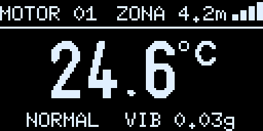
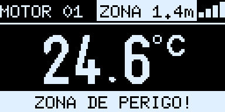
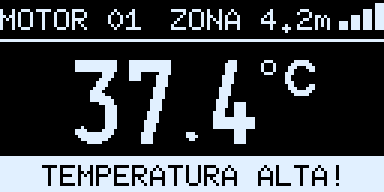
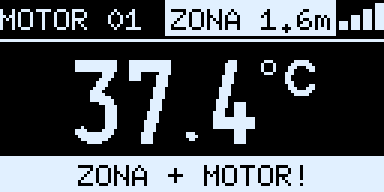
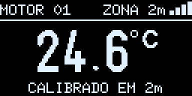
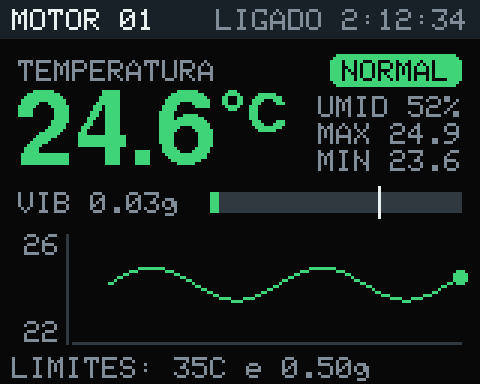
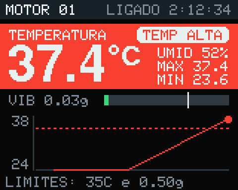
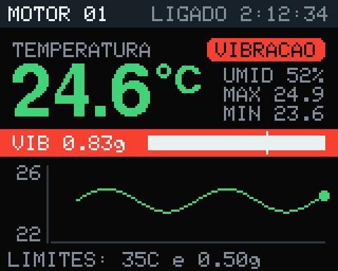

# Guia de uso

## Gravando os firmwares

1. Instale o **Arduino IDE 2** (ou o `arduino-cli`) e, em *Preferências → URLs adicionais*, cole:
   `https://espressif.github.io/arduino-esp32/package_esp32_index.json`
2. No Gerenciador de Placas, instale **esp32 by Espressif Systems** (versão 3.x; o projeto usou a 3.3.12).
3. No Gerenciador de Bibliotecas, instale:
   - para o **ESP2 (Sentinela):** *DHT sensor library* (Adafruit), *Adafruit Unified Sensor*, *Adafruit GFX Library* e *Adafruit ST7735 and ST7789 Library*;
   - para o **ESP1 (SentryBand):** *U8g2* (de oliver);
   - o MPU6050 e o ESP3 não precisam de biblioteca.
4. Grave cada pasta na sua placa:

| Pasta | Placa no IDE | Observação |
|---|---|---|
| `esp1_pulseira` | ESP32 Dev Module | |
| `esp2_motor` | ESP32 Dev Module | se a gravação cair no meio, use *Upload Speed* 460800 |
| `esp3_zona` | ESP32S3 Dev Module | *USB CDC On Boot: Enabled*, para ver as mensagens pela USB |

Pela linha de comando:

```bash
arduino-cli compile --fqbn esp32:esp32:esp32 --upload -p /dev/ttyUSB0 esp1_pulseira
arduino-cli compile --fqbn esp32:esp32:esp32:UploadSpeed=460800 --upload -p /dev/ttyUSB0 esp2_motor
arduino-cli compile --fqbn esp32:esp32:esp32s3:CDCOnBoot=cdc --upload -p /dev/ttyACM0 esp3_zona
```

> A pulseira e a máquina precisam estar com a **mesma versão do protocolo** (hoje, a 4). Se mudar o formato da mensagem num firmware, grave os dois.

## Colocando para funcionar

1. **ESP3 (zona):** ligue numa fonte USB no centro da área perigosa, no alto e longe de metal.
2. **ESP2 (Sentinela):** ligue perto da máquina, com o MPU6050 bem preso à estrutura e o DHT11 no ar em volta dela, sem encostar em superfícies quentes.
3. **ESP1 (SentryBand):** ao ligar, dá um bipe curto e acende os dois LEDs por meio segundo (teste do buzzer e dos LEDs). Em poucos segundos, a tela mostra a temperatura da máquina e a distância até a zona.

A ordem em que as placas são ligadas não importa.

## O que a SentryBand mostra

| Situação | Tela | Bipe | LED azul | LED amarelo |
|---|---|---|---|---|
| Tudo certo | `NORMAL  VIB 0.03g` | – | aceso | apagado |
| Temperatura alta | `TEMPERATURA ALTA!` (faixa piscando) | 3 curtos | apagado | pisca rápido |
| Vibração alta | `VIBRACAO ALTA!` | 2 longos | apagado | pisca rápido |
| Dentro da zona de perigo | `ZONA DE PERIGO!` e a distância invertida no topo | 5 rápidos e agudos | apagado | pisca rápido |
| Zona + alarme da máquina | `ZONA + MOTOR!` | alterna os padrões | apagado | pisca rápido |
| Máquina sem sinal há mais de 10 s | `SEM SINAL HA 15s` | – | apagado | pisca devagar |
| Sensor de temperatura com erro | `ERRO SENSOR TEMP` | – | apagado | pisca devagar |
| Ligando, ainda sem a máquina | `PROCURANDO O MOTOR` | – | apagado | pisca devagar |

| | |
|---|---|
|  |  |
|  |  |

As quatro barrinhas no canto mostram a força do sinal da máquina.

## Zona de perigo: escolher a distância e calibrar

Tudo é feito no botão **BOOT** da pulseira (em algumas placas ele vem escrito **IO0**; o outro botão, **EN**, reinicia a placa).

1. **Escolher a distância:** dê toques rápidos no BOOT. Cada toque passa para a próxima opção, 1 → 2 → 3 → 5 m, e a tela confirma, por exemplo, `ZONA DE 2m`.
2. **Calibrar:** fique **parado exatamente nessa distância** do ESP3, de frente para ele, com a pulseira no pulso como vai ser usada. **Segure o BOOT por 3 segundos**, mexendo a pulseira devagar. Ela dá 2 bipes agudos e mostra `CALIBRADO EM 2m`. A borda da zona passa a ser ali.
3. Se aparecer `SEM SINAL DA ZONA`, o ESP3 está desligado ou longe demais. Nada é alterado.

A distância e a calibração ficam salvas mesmo desligando a pulseira. Recalibre se mudar o ESP3 de lugar.

**Dicas de precisão:**
- a distância vem da força do sinal e é aproximada;
- paredes, metal e o próprio corpo mudam o sinal;
- se o perigo real começa a 2 m, configure 3 m para ter margem.



## O painel do Sentinela (TFT)



- **Topo:** número da máquina e há quanto tempo ela está ligada.
- **Temperatura:** valor grande (verde normal, vermelho no alarme), selo da situação, umidade, máxima e mínima.
- **VIB:** vibração atual em g. A barra fica verde abaixo do limite e vermelha acima, e o tracinho branco marca o limite.
- **Gráfico:** temperatura dos últimos 15 minutos, com uma linha vermelha tracejada no limite quando ele entra na escala.
- **Rodapé:** limites em uso (`LIMITES: 35C e 0.50g`).

| Temperatura alta | Vibração alta |
|---|---|
|  |  |

## Ajustando os limites

Todos os limites dos alarmes da máquina ficam no começo de `esp2_motor/esp2_motor.ino`. Basta regravar o ESP2: a pulseira recebe os valores novos sozinha.

```cpp
const float LIMITE_ALARME = 35.0;     // °C: a partir daqui a pulseira bipa
const float HISTERESE     = 1.0;      // o alarme só desliga 1 °C abaixo do limite
const float   LIMITE_VIBRACAO        = 0.50;   // g: acima disso a pulseira bipa
const uint8_t SEGUNDOS_PARA_LIGAR    = 2;      // precisa passar do limite 2 s seguidos
const uint8_t SEGUNDOS_PARA_DESLIGAR = 3;      // e ficar 3 s abaixo de 80% do limite para parar
```

Para escolher o limite de vibração, veja o valor de **VIB** na TFT com a máquina funcionando normal e use de 2 a 3 vezes esse valor.

Na pulseira (`esp1_pulseira/esp1_pulseira.ino`) ficam as opções de distância da zona (`DISTANCIAS_M`), o tom dos bipes (`FREQ_BIP`, `FREQ_ZONA`) e a quantidade de LEDs (`QUANTIDADE_LEDS`, 2 ou 4).

## Problemas comuns

| Sintoma | O que fazer |
|---|---|
| Pulseira mostra `SEM SINAL` | o ESP2 está desligado ou longe; confira se os dois estão com o firmware atual (mesma versão do protocolo) |
| TFT mostra `VIB SEM SENSOR` | confira o MPU6050: VCC no 3V3, SDA no GPIO 33, SCL no GPIO 32 e os pinos do módulo soldados. Ele é encontrado sozinho em até 5 s depois de corrigido |
| TFT mostra `ERRO SENSOR` | confira o DHT11: S no GPIO 4, + no 3V3, − no GND |
| TFT branca ou com cores trocadas | troque `TIPO_TELA` para `INITR_GREENTAB` ou `INITR_REDTAB`; de cabeça para baixo, troque `ROTACAO_TELA` para 3 |
| OLED apagada | confira SDA no GPIO 21 e SCL no GPIO 22; o Monitor Serial (115200) diz se a tela foi encontrada |
| Buzzer mudo | ele é passivo e precisa do firmware (tom por PWM); confira o S no GPIO 32 |
| Som fraco | cada buzzer passivo é mais alto num tom diferente: teste `FREQ_BIP` entre 2000 e 4000 Hz |
| LED não acende no teste ao ligar | inverta as pontas do filamento (com 3 V ele não estraga) |
| A distância da zona parece errada | calibre de novo no lugar de uso, parado na borda e com a pulseira no pulso |
| A gravação para em `Connecting...` | segure o botão BOOT até começar a gravar |
| A gravação cai no meio | grave de novo com *Upload Speed* 460800 |

O **Monitor Serial a 115200 baud** de cada placa mostra tudo o que ela está fazendo: leituras, envios, mudanças de estado e distância da zona.
