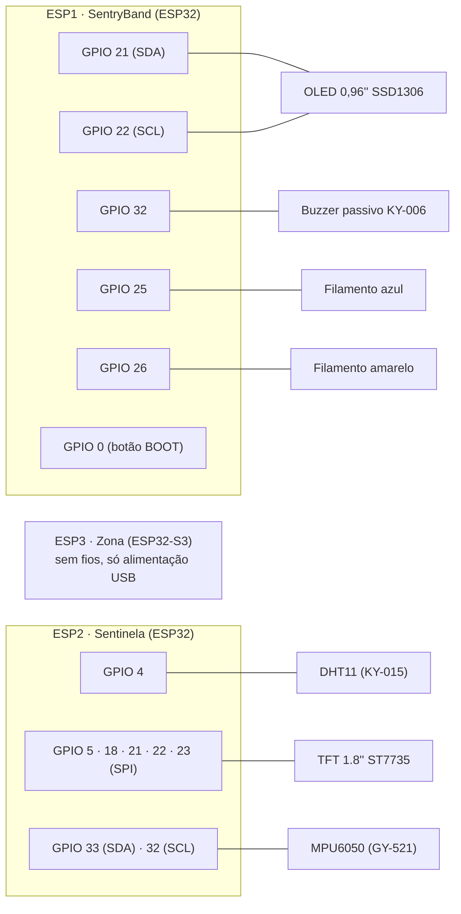

# Hardware e ligações

Este documento lista todos os componentes do projeto e onde cada fio foi ligado, exatamente como no protótipo apresentado.

## Lista de materiais

| Qtd | Componente | Onde fica | Função |
|---|---|---|---|
| 1 | Placa ESP32 DevKit (módulo ESP-32S, chip ESP32-D0WD-V3, 4 MB de flash) | ESP1 – SentryBand | Recebe os dados por rádio, mede a distância até a zona e dá os alertas |
| 1 | Placa ESP32 DevKit tradicional (chip ESP32-D0WD-V3) | ESP2 – Sentinela | Lê os sensores, decide os alarmes e transmite |
| 1 | Placa ESP32-S3 mini (ESP32-S3 QFN56, 4 MB de flash e 2 MB de PSRAM embutidos, USB nativa) | ESP3 – zona de perigo | Farol de rádio que marca o centro da zona |
| 1 | Display OLED 0,96" 128×64, controlador SSD1306, I2C (4 pinos) | ESP1 | Tela da pulseira |
| 1 | Buzzer passivo KY-006 | ESP1 | Bipes de alerta (tons gerados por PWM) |
| 2 | Filamento de LED DC 3 V / 100 mA, 38 mm (azul e branco quente/amarelo) | ESP1 | Sinalização visual: azul = tudo certo, amarelo = perigo ou problema |
| 1 | Módulo DHT11 de temperatura e umidade (KY-015, com resistor de pull-up) | ESP2 | Temperatura do ar perto da máquina (indício de incêndio ou superaquecimento) |
| 1 | Módulo MPU6050 (GY-521), acelerômetro e giroscópio de 3 eixos, I2C | ESP2 | Vibração da máquina (indício de impacto ou acidente) |
| 1 | Display TFT 1.8" 160×128, controlador ST7735, SPI | ESP2 | Painel da máquina |
| – | Protoboard, jumpers fêmea-fêmea e fêmea-macho, cabos USB de dados | todos | Montagem e alimentação |

O giroscópio do MPU6050 não é usado: para medir vibração basta o acelerômetro.

## Visão geral das ligações

## ESP1 – SentryBand (pulseira)

| ESP | Módulo | Pino do módulo | Liga no pino |
|---|---|---|---|
| **ESP1 (SentryBand)** | Tela OLED 0,96" | VCC | 3V3 |
| | | GND | GND |
| | | SCL | GPIO 22 |
| | | SDA | GPIO 21 |
| | Buzzer passivo KY-006 | S | GPIO 32 |
| | | meio | não liga |
| | | − | GND |
| | Filamento de LED azul | + | GPIO 25 |
| | | − | GND |
| | Filamento de LED amarelo | + | GPIO 26 |
| | | − | GND |

- Os filamentos são ligados **direto no pino, sem resistor**. O firmware põe esses pinos na força de saída média (`GPIO_DRIVE_CAP_2`), e a resistência interna da saída limita a corrente em uns 15 mA. Detalhes em [algoritmos.md](algoritmos.md#leds-de-situação).
- Nunca ligue um filamento direto no 3V3 ou no 5V: ele puxaria 100 mA.
- O botão **BOOT** da própria placa (GPIO 0, escrito "IO0" em algumas placas) controla a zona de perigo. Não precisa de fio.
- O firmware também aceita 4 LEDs (`QUANTIDADE_LEDS 4`): um par azul/amarelo para a máquina (GPIO 25 e 26) e outro para a zona (GPIO 27 e 33).

## ESP2 – Sentinela (máquina)

| ESP | Módulo | Pino do módulo | Liga no pino |
|---|---|---|---|
| **ESP2 (Sentinela)** | DHT11 (KY-015) | S | GPIO 4 |
| | | meio (+) | 3V3 |
| | | − | GND |
| | Tela TFT 1.8" (ST7735) | VCC | 3V3 |
| | | GND | GND |
| | | CS | GPIO 5 |
| | | RESET | GPIO 22 |
| | | A0 (DC) | GPIO 21 |
| | | SDA (MOSI) | GPIO 23 |
| | | SCK | GPIO 18 |
| | | LED (luz de fundo) | 3V3 |
| | MPU6050 (GY-521) | VCC | 3V3 |
| | | GND | GND |
| | | SCL | GPIO 32 |
| | | SDA | GPIO 33 |
| | | XDA, XCL, AD0, INT | não liga |

- A TFT usa o SPI de hardware do ESP32 (VSPI: SCK 18, MOSI 23). O MISO (GPIO 19) fica reservado pelo barramento, mesmo sem uso.
- Os pinos 21 e 22, que são o I2C padrão do ESP32, ficaram com a TFT (A0 e RESET). Por isso o MPU6050 usa um **segundo par de pinos para I2C (33 e 32)**: o ESP32 roteia o I2C para qualquer pino pela matriz de GPIO.
- O MPU6050 precisa ficar **bem preso na máquina** (parafuso, fita dupla face forte ou abraçadeira). Solto, ele balança sozinho e mede errado.
- No protótipo, os pinos do módulo MPU6050 vieram sem solda e davam mau contato. Soldar os pinos resolveu (veja [verificacao-e-testes.md](verificacao-e-testes.md)).

## ESP3 – zona de perigo

Não tem nenhuma ligação. A placa só precisa de energia pela USB (carregador de celular ou power bank) e deve ficar no centro da área perigosa: perto da máquina, no alto (1 a 1,5 m) e longe de superfícies de metal, que refletem o sinal.

## Alimentação e cuidados elétricos

- **Todos os módulos são alimentados no 3V3** da placa. Os pinos do ESP32 não aceitam 5 V, e vários módulos (DHT11, MPU6050 e OLED) devolvem sinal para o ESP. Com 3,3 V eles nunca mandam mais do que o pino suporta.
- Nas placas com vários módulos, o 3V3 e o GND passam pelas fileiras da protoboard para chegar a todos.
- Cada ESP é alimentado pela USB de 5 V; o regulador da placa gera os 3,3 V.
- Pinos de *strapping* (0, 2, 5, 12 e 15) foram evitados ou usados de forma segura. O GPIO 0 é só lido depois do boot (botão), o 2 é o LED da placa e o 5 é o CS da TFT, que fica em nível alto no boot.

## Mapa de pinos usados

| Placa | GPIO | Uso |
|---|---|---|
| ESP1 | 0 | botão BOOT (entrada com pull-up) |
| ESP1 | 2 | LED azul da placa (pisca a cada mensagem do motor) |
| ESP1 | 21 / 22 | I2C da OLED (SDA / SCL) |
| ESP1 | 25 / 26 | filamentos azul / amarelo |
| ESP1 | 27 / 33 | livres (usados só no modo de 4 LEDs) |
| ESP1 | 32 | buzzer (PWM pelo LEDC) |
| ESP2 | 2 | LED azul da placa (troca de estado a cada envio) |
| ESP2 | 4 | dados do DHT11 |
| ESP2 | 5 / 18 / 21 / 22 / 23 | TFT: CS / SCK / DC / RESET / MOSI |
| ESP2 | 32 / 33 | I2C do MPU6050 (SCL / SDA) |
| ESP3 | – | nenhum pino usado |
