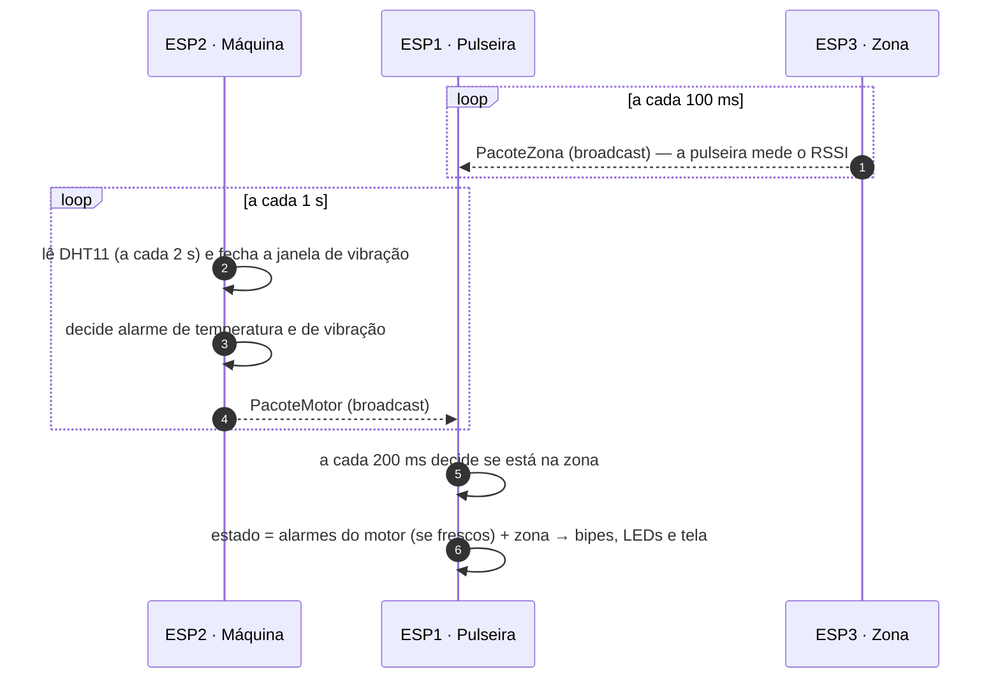

# Protocolo de comunicação (ESP-NOW)

## Por que ESP-NOW

As três placas conversam por **ESP-NOW**, protocolo da Espressif que manda quadros curtos (até 250 bytes) direto de um ESP32 para outro, usando o rádio Wi-Fi de 2,4 GHz **sem roteador, sem rede e sem internet**.

- **Latência de poucos milissegundos:** não há associação nem handshake, e o quadro sai na hora.
- **Broadcast:** quem envia manda para o endereço `FF:FF:FF:FF:FF:FF`, e qualquer ESP32 no mesmo canal recebe. Assim é fácil acrescentar novas pulseiras ou zonas.
- **Não cria rede Wi-Fi:** por isso o ESP3 não aparece na lista de redes do celular. Os quadros ESP-NOW são *action frames* do 802.11, que os celulares ignoram.

A ideia inicial para a zona de perigo era transformar o ESP3 num roteador (ponto de acesso) e a pulseira procurar a rede. A troca por um farol de ESP-NOW foi proposital: uma busca de redes Wi-Fi leva de 1 a 2 s e faz o rádio pular de canal. Durante esse tempo a pulseira não recebe os dados da máquina. O farol fala no mesmo canal que a pulseira já escuta, então ela mede a força do sinal 10 vezes por segundo sem perder nenhuma mensagem do motor.

## Configuração do rádio

Igual nos três firmwares:

```cpp
WiFi.mode(WIFI_STA);
WiFi.disconnect();
esp_wifi_set_promiscuous(true);                            // truque para poder fixar o canal
esp_wifi_set_channel(CANAL_ESPNOW, WIFI_SECOND_CHAN_NONE); // canal 1 = 2412 MHz
esp_wifi_set_promiscuous(false);
esp_now_init();
```

- **Quem envia** (ESP2 e ESP3) registra o *peer* de broadcast no canal 1 e chama `esp_now_send()`.
- **A pulseira** só registra a função de recepção (`esp_now_register_recv_cb`). Para receber broadcast não é preciso cadastrar *peers*.
- **O ESP3** fixa a potência de transmissão em `WIFI_POWER_8_5dBm`. A distância é calculada pela força do sinal, então a potência não pode mudar depois de calibrar.

## Quem manda o quê



| Mensagem | Enviada por | Frequência | Tamanho | Assinatura |
|---|---|---|---|---|
| `PacoteMotor` v4 | ESP2 (máquina) | 1 por segundo | 35 bytes | `0x4E425431` ("NBT1") |
| `PacoteZona` v1 | ESP3 (zona) | 10 por segundo | 10 bytes | `0x4E425A31` ("NBZ1") |

## Formato das mensagens

As estruturas são declaradas com `__attribute__((packed))`, sem bytes de preenchimento, e precisam ser **idênticas** em quem envia e em quem recebe. O ESP32 é *little-endian*.

### PacoteMotor (versão 4, 35 bytes)

| Byte | Campo | Tipo | Significado |
|---|---|---|---|
| 0 | `magico` | `uint32_t` | Sempre `0x4E425431`: marca que a mensagem é do projeto |
| 4 | `versao` | `uint8_t` | `4` |
| 5 | `idMotor` | `uint8_t` | Número da máquina (1 a 255) |
| 6 | `sensorOk` | `uint8_t` | 1 = DHT11 com leitura válida; 0 = sensor com problema |
| 7 | `umidade` | `uint8_t` | Umidade relativa em % (255 = sem leitura) |
| 8 | `sequencia` | `uint32_t` | Contador 1, 2, 3… usado para contar mensagens perdidas |
| 12 | `temperaturaC` | `float` | Temperatura em °C (`NAN` se o sensor falhou) |
| 16 | `ligadoHaSeg` | `uint32_t` | Há quantos segundos o ESP2 está ligado |
| 20 | `limiteC` | `float` | Limite de temperatura em uso no ESP2 |
| 24 | `vibracaoG` | `float` | Vibração do último segundo, em g (`NAN` sem o MPU6050) |
| 28 | `limiteVibracaoG` | `float` | Limite de vibração em uso no ESP2 |
| 32 | `alarme` | `uint8_t` | 1 = temperatura muito alta |
| 33 | `vibracaoOk` | `uint8_t` | 1 = MPU6050 respondendo |
| 34 | `alarmeVibracao` | `uint8_t` | 1 = vibração muito alta |

Os alarmes são **decididos na máquina** e só obedecidos pela pulseira. Assim a TFT e a OLED nunca discordam, e os limites são mudados num lugar só (`esp2_motor.ino`).

### PacoteZona (versão 1, 10 bytes)

| Byte | Campo | Tipo | Significado |
|---|---|---|---|
| 0 | `magico` | `uint32_t` | Sempre `0x4E425A31` |
| 4 | `versao` | `uint8_t` | `1` |
| 5 | `idZona` | `uint8_t` | Número da zona (1 a 255) |
| 6 | `sequencia` | `uint32_t` | Contador de sinais enviados |

O conteúdo quase não importa: o que a pulseira usa é a **força com que o quadro chegou** (RSSI, em dBm), que vem em `info->rx_ctrl->rssi` na função de recepção.

## Recepção na pulseira

```cpp
void aoReceberPacote(const esp_now_recv_info_t *info, const uint8_t *dados, int tamanho) {
  int rssi = info->rx_ctrl->rssi;
  if (tamanho == sizeof(PacoteZona)) {   // 10 bytes: farol da zona
    /* confere magico/versao e soma o RSSI (dentro da trava) */
    return;
  }
  if (tamanho != sizeof(PacoteMotor)) return;   // 35 bytes: máquina
  /* confere magico, versao e, se configurado, o ID do motor; copia o pacote */
}
```

1. **Separação pelo tamanho:** 10 bytes é farol e 35 bytes é máquina. Qualquer outro tamanho é descartado.
2. **Assinatura e versão:** mensagens de outros projetos ou de firmwares antigos são ignoradas. Se só uma das placas for atualizada, a pulseira mostra "SEM SINAL" em vez de interpretar dados errados.
3. **Filtro de máquina:** com `ID_MOTOR_ESPERADO` diferente de 0, a pulseira só aceita aquela máquina.
4. **Concorrência:** a função de recepção roda na tarefa do Wi-Fi, e o `loop()` em outra tarefa. A cópia do pacote e as somas de RSSI ficam protegidas por uma trava `portMUX` (*spinlock*). A função só copia os dados; todo o processamento acontece no `loop()`.

## Dados frescos e perdas

- **Máquina:** depois de **10 s** sem `PacoteMotor`, os dados são considerados velhos. A pulseira mostra "SEM SINAL HA Xs", ignora os alarmes que tinham chegado e o LED amarelo pisca devagar. A zona de perigo continua funcionando.
- **Zona:** depois de **3 s** sem `PacoteZona`, a pulseira considera a zona fora de alcance (ESP3 desligado ou longe).
- **Perdas:** a pulseira compara o campo `sequencia` com o anterior e acumula quantas mensagens faltaram (aparece no Monitor Serial). Nos testes de bancada, a pulseira recebeu 7 de 7 mensagens, com RSSI entre −37 e −49 dBm.

## Histórico de versões do protocolo

| Versão | Mudança |
|---|---|
| 1 | Primeiro protótipo, com sensor DS18B20 |
| 2 | Troca pelo DHT11; entra o campo de umidade |
| 3 | O alarme de temperatura passa a ser decidido na máquina (`limiteC`, `alarme`) |
| 4 | Entra o MPU6050 (`vibracaoG`, `limiteVibracaoG`, `vibracaoOk`, `alarmeVibracao`) e o envio passa de 2 s para 1 s |

## Segurança: limitação conhecida

O protótipo usa broadcast **sem criptografia nem autenticação**. Qualquer pessoa com um ESP32 no canal 1 poderia forjar mensagens, por exemplo um "tudo normal" falso ou um farol falso. Para uso real, o caminho seria:

- trocar o broadcast por *peers* cadastrados e ligar a criptografia nativa do ESP-NOW (chaves PMK/LMK, AES-CCMP);
- ou acrescentar uma assinatura HMAC com chave compartilhada, junto com o número de sequência ou um contador de tempo, para impedir a repetição de mensagens antigas.
