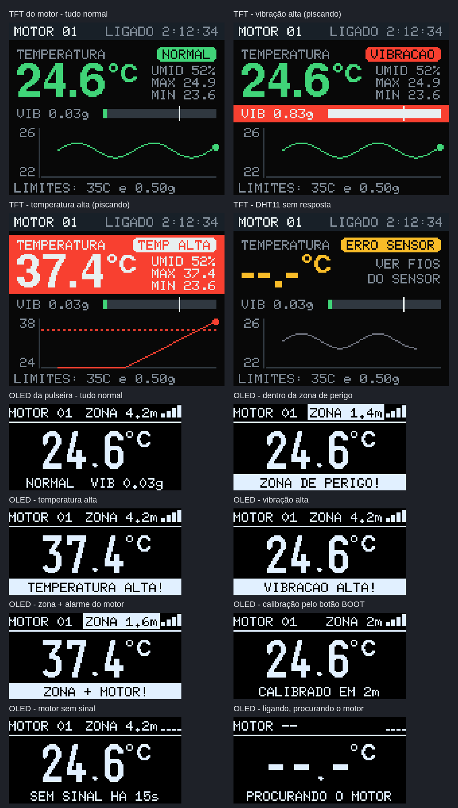

# Verificação e testes

O projeto foi verificado em quatro níveis antes e durante os testes nas placas:

1. compilação sem nenhum aviso;
2. simulação da lógica em Python;
3. desenho das telas no PC;
4. diagnósticos e testes no hardware real.

## Ambiente

| Item | Versão |
|---|---|
| Arduino core para ESP32 (Espressif) | 3.3.12 |
| arduino-cli (o mesmo do Arduino IDE 2) | 1.5.1 |
| esptool | 5.3.1 |
| DHT sensor library (Adafruit) | 1.4.7 |
| Adafruit Unified Sensor | 1.1.15 |
| Adafruit GFX Library | 1.13.0 |
| Adafruit ST7735 and ST7789 Library | 1.12.0 |
| Adafruit BusIO (dependência) | 1.17.4 |
| U8g2 | 2.36.19 |

## 1. Compilação

Os três firmwares compilam com `--warnings all` e **nenhum aviso** nos arquivos do projeto:

| Firmware | Placa (FQBN) | Flash | RAM |
|---|---|---|---|
| `esp1_pulseira` | `esp32:esp32:esp32` | 939 023 B (71%) | 48 804 B (14%) |
| `esp2_motor` | `esp32:esp32:esp32` | 943 908 B (72%) | 48 032 B (14%) |
| `esp3_zona` | `esp32:esp32:esp32s3:CDCOnBoot=cdc` | 867 849 B (66%) | 44 904 B (13%) |

O farol (`esp3_zona`) também foi compilado para ESP32 clássico e ESP32-C3, para garantir que roda em qualquer placa.

## 2. Simulação da lógica

[`ferramentas/simular.py`](../ferramentas/simular.py) traz as funções de decisão dos três firmwares portadas linha a linha para Python. Os limites e parâmetros são lidos direto dos `.ino`, então os testes acompanham o código. Ele verifica:

- **Pacotes:** as estruturas são iguais em quem envia e em quem recebe, e têm tamanhos diferentes entre si.
- **Temperatura:** a histerese e a tolerância a falhas do DHT11, leitura por leitura.
- **Vibração:** sinais de acelerômetro sintéticos (gravidade, vibração senoidal e ruído de 5 mg, com a lacuna do redesenho da tela). Confere o RMS, a persistência de 2 s e o desligamento depois de 3 s.
- **Zona de perigo:** caminhadas até o farol e de volta, com o RSSI gerado pelo modelo log-distância mais ruído gaussiano de 3 dB, como o rádio entrega (em dBm inteiros). Também testa ficar parado na borda, desligar o farol e a zona funcionar com a máquina sem sinal.
- **Bipes:** padrões, tons e rodízio entre alarmes.
- **Botão BOOT:** troca de distância, calibração sem farol, calibração na borda e a precisão estatística depois de calibrar.
- **LEDs:** o comportamento de cada LED em cada situação.

```
python3 ferramentas/simular.py
```

Resultado atual: **46 de 46 verificações passaram.**

<details>
<summary>Saída completa</summary>

```
0) Formato dos pacotes ESP-NOW
  OK     PacoteMotor igual na pulseira e no motor   [35 bytes, 14 campos]
  OK     PacoteZona igual na pulseira e no farol   [10 bytes]
  OK     tamanhos diferentes (a pulseira separa os pacotes pelo tamanho)
  OK     versões iguais dos dois lados   [motor v4, zona v1]

1) ESP2 - temperatura (liga em 35 °C, desliga em 34 °C, erro após 3 falhas)
  OK        25 °C -> alarme=não: bem abaixo
  OK      34.5 °C -> alarme=não: quase no limite
  OK        35 °C -> alarme=SIM: chegou no limite
  OK      34.5 °C -> alarme=SIM: caiu um pouco: histerese segura o alarme
  OK        34 °C -> alarme=não: caiu 1 °C: desliga
  OK      34.5 °C -> alarme=não: subiu de novo, mas abaixo do limite
  OK        36 °C -> alarme=SIM: passou do limite
  OK        falha -> alarme=SIM: 1ª falha do DHT11: repete a última leitura
  OK        falha -> alarme=SIM: 2ª falha
  OK        falha -> alarme=não: 3ª falha: sensor com erro, alarme sai
  OK        37 °C -> alarme=SIM: sensor voltou quente

2) ESP2 - vibração (limite 0.5 g; liga após 2 s acima; desliga após 3 s abaixo de 0.40 g)
  OK     motor parado: perto de 0 g, sem alarme   [0.009 g]
  OK     vibração fraca (0,3 g de pico): RMS certo e sem alarme   [0.212 g; o esperado é 0,3/√2 = 0.212]
  OK     uma batida (1 s forte): ainda sem alarme   [0.707 g]
  OK     forte por 2 s seguidos: ALARME   [0.707 g]
  OK     entre 80% e 100% do limite: o alarme continua   [0.424 g]
  OK     abaixo de 80%: desliga só no 3º segundo   [[True, True, False]]
  OK     MPU6050 desconectado (poucas medidas): sem alarme
  OK     vibração de 3 g a 120 Hz medida sem saturar (±4 g)   [2.122 g]

3) ESP1 - zona de perigo (borda padrão 2 m: -60 dBm a 1 m, n = 2.5, histerese 3 dB, média a cada 200 ms com peso 0.5/0.3)
  OK     andando a 0.5 m/s (20 caminhadas): entra perto da borda, sai um pouco depois, sem liga-desliga   [entra em média a 2.02 m (1.7-2.6), sai a 3.00 m; trocas a mais: 0]
  OK     andando a 1 m/s (20 caminhadas): entra perto da borda, sai um pouco depois, sem liga-desliga   [entra em média a 1.75 m (1.4-2.4), sai a 3.36 m; trocas a mais: 0]
  OK     parado exatamente na borda por 30 s: não fica entrando e saindo   [1 trocas]
  OK     farol desligado: depois de ~3 s sai da zona e para de bipar
  OK     motor parou de mandar: SEM SINAL
  OK     e a zona continua funcionando sozinha

4) ESP1 - bipes de cada alarme (e rodízio quando há mais de um)
  OK     temperatura: trios de 120 ms a 2500 Hz   [[120, 120, 120, 120, 120, 120]]
  OK     vibração: duplas de 350 ms a 2500 Hz   [[350, 350, 350, 350]]
  OK     zona: cinco de 60 ms a 3500 Hz (mais agudo)   [[60, 60, 60, 60, 60]]
  OK     temperatura + vibração: alterna trio curto e dupla longa   [[120, 120, 120, 350, 350, 120, 120]]
  OK     temperatura + zona: alterna trio e cinco rápidos   [[120, 120, 120, 60, 60, 60, 60, 60, 120, 120]]

5) ESP1 - botão BOOT
  OK     toque rápido percorre as distâncias e volta ao início   [2 m -> 3 m -> 5 m -> 1 m -> 2 m]
  OK     segurar 3 s sem o farol: avisa e não muda nada
  OK     segurar 3 s parado a 2 m: calibra a borda ali (o sinal real a 1 m é -50 dBm)   [equivale a -49.0 dBm a 1 m]
  OK     escolheu 2 m, calibrou lá e voltou devagar: entra em média perto de 2 m (20 repetições)   [média 2.25 m, de 1.7 a 2.9 m]
  OK     escolheu 3 m, calibrou lá e voltou devagar: entra em média perto de 3 m (20 repetições)   [média 3.41 m, de 2.8 a 4.3 m]

6) ESP1 - LEDs (modo de 2 LEDs: azul no D25, amarelo no D26)
  OK     tudo perfeito          azul ACESO         amarelo apagado
  OK     temperatura alta       azul apagado       amarelo pisca rápido
  OK     vibração alta          azul apagado       amarelo pisca rápido
  OK     dentro da zona         azul apagado       amarelo pisca rápido
  OK     DHT11 com erro         azul apagado       amarelo pisca devagar
  OK     MPU6050 sem resposta   azul apagado       amarelo pisca devagar
  OK     motor desligado        azul apagado       amarelo pisca devagar

RESULTADO: tudo certo
```

</details>

### Ajuste da zona de perigo

A forma de suavizar o RSSI foi escolhida com [`ferramentas/ajuste_zona.py`](../ferramentas/ajuste_zona.py). Para cada configuração, ele simula 20 caminhadas até o farol e de volta (borda real em 2 m, ruído de 3 dB) e conta quantas vezes o alarme troca de estado com a pessoa parada na borda por 60 s. O ideal é 1: entrou e ficou.

| decide a cada | peso sobe/desce | 0,5 m/s: entra / sai | 1 m/s: entra / sai | trocas parado na borda (60 s) |
|---|---|---|---|---|
| 500 ms | 0,5 / 0,5 | 1,6 m / 3,2 m | 1,0 m / 3,8 m | 1,0 |
| 500 ms | 0,7 / 0,3 | 1,7 m / 3,6 m | 1,4 m / 4,6 m | 1,0 |
| 200 ms | 0,5 / 0,5 | 2,0 m / 2,6 m | 1,7 m / 3,0 m | 4,0 |
| **200 ms** | **0,5 / 0,3 (escolhida)** | **2,0 m / 2,9 m** | **1,7 m / 3,4 m** | **1,0** |
| 100 ms | 0,3 / 0,3 | 2,0 m / 2,5 m | 1,8 m / 2,9 m | 7,6 |
| 100 ms | 0,4 / 0,3 | 2,2 m / 2,5 m | 2,0 m / 2,9 m | 6,2 |
| 100 ms | 0,5 / 0,3 | 2,3 m / 2,5 m | 2,1 m / 3,0 m | 4,5 |
| 100 ms | 0,5 / 0,5 | 2,3 m / 2,2 m | 2,1 m / 2,6 m | 35,4 |

- A primeira linha é a configuração inicial: uma pessoa andando a 1 m/s só era avisada a 1,0 m de uma zona de 2 m.
- Decidir mais rápido adianta o aviso, mas, com pesos iguais, faz o alarme ficar liga-desliga na borda.
- A escolhida é a única que avisa perto da borda e não fica liga-desliga parada nela.

Uma tentativa intermediária, decidir a cada 500 ms com pesos 0,7/0,3, parecia boa na teoria, mas a simulação mostrou que não adiantava o aviso e atrasava a saída. Por isso as decisões foram tomadas com números, e não por intuição.

## 3. Desenho das telas no PC

[`ferramentas/telas.py`](../ferramentas/telas.py) desenha a TFT e a OLED **pixel a pixel como na placa**:

- as funções de desenho dos sketches foram copiadas linha a linha;
- os algoritmos gráficos são os da Adafruit GFX (linha de Bresenham, círculo de ponto médio, retângulo arredondado);
- as fontes são lidas das próprias bibliotecas instaladas: os arquivos `.h` da Adafruit GFX e a `u8g2_fonts.c` da U8g2, com o descompactador de glifos da U8g2 reescrito em Python.

Isso permitiu conferir, antes de gravar, que nenhum texto sai da tela ou fica por cima de outro, em todos os estados. As imagens estão em [imagens/](imagens/).



## 4. Diagnósticos de hardware

Quando algo não funcionava na bancada, em vez de pedir para conferir fio por fio, foram gravados por alguns segundos pequenos programas de diagnóstico. Depois o firmware normal era gravado de volta.

| Situação | Técnica | Resultado |
|---|---|---|
| Identificar as placas | `esptool chip-id` | Confirmou o chip de cada placa (ESP32-D0WD-V3 nas duas DevKit; ESP32-S3 no farol) e serviu para identificar cada uma pelo MAC antes de gravar, sem risco de trocar os códigos |
| Primeira leitura do cristal deu 26 MHz | repetir a medição | As leituras seguintes deram 40 MHz. Era um erro na primeira conexão, e as mensagens legíveis a 115200 baud confirmaram o cristal de 40 MHz |
| MPU6050 não respondia | ler todos os GPIOs com pull-down interno: os pinos ligados ao SDA/SCL de um módulo alimentado ficam em nível alto por causa dos resistores dele | Os GPIOs 32 e 33 ficaram em nível baixo, ou seja, o sinal não chegava. Era mau contato nos pinos do módulo, resolvido soldando |
| OLED não respondeu depois de uma regravação | leitura das linhas SDA/SCL antes de iniciar | Levou à rotina de destravar o I2C (9 pulsos no SCL) nos dois firmwares |
| Como os filamentos de LED estavam ligados, e com que tensão | conversor analógico (ADC2, com o Wi-Fi desligado) medindo cada pino com pull-up, com pull-down e solto; um pino livre como referência | Pull-down ≈ 0 V e pull-up ≈ 2,45 V mostraram o + no pino e o − no GND, e LEDs de InGaN (~2,45 V a ~19 µA). Com isso foi escolhida a força de saída `CAP_2` (~15 mA) |
| Ler as mensagens das placas sem o Monitor Serial | script Python com `termios`: reinicia a placa pela linha RTS, como o esptool, e lê a 115200 baud | Permitiu confirmar cada gravação lendo as mensagens de inicialização |

## 5. Testes no hardware

| Teste | Resultado |
|---|---|
| Comunicação máquina → pulseira na bancada | 7 de 7 mensagens recebidas, sem perdas, RSSI entre −37 e −49 dBm |
| Alarme de temperatura (sensor aquecido até o limite) | a pulseira bipou ao chegar no limite, "tudo em tempo real" |
| Acelerômetro (depois de soldar o módulo) | encontrado no endereço 0x68; vibração de ~0,00 g com a máquina parada |
| Zona de perigo | funcionou e é usável; a distância é aproximada, como esperado para RSSI |
| LEDs | azul aceso com tudo certo; amarelo piscando no perigo e devagar sem a máquina |
| Funcionamento longe do PC | as três placas alimentadas por fontes USB, comunicando normalmente |
| Apresentação no Ideathon | sistema completo demonstrado ao vivo |

## Problemas encontrados e soluções

| Problema | Causa | Solução |
|---|---|---|
| O buzzer não apitava | é um buzzer **passivo**, que precisa de uma onda quadrada | tom de 2500 Hz pelo PWM (LEDC) com `ledcWriteTone()` |
| A OLED parou de responder depois de uma regravação | I2C travado: o escravo segurava o SDA porque o ESP reiniciou no meio de uma transmissão | rotina de destravar (até 9 pulsos no SCL e STOP) antes de iniciar o I2C |
| O MPU6050 não era encontrado | pinos do módulo sem solda, com mau contato | diagnóstico com pull-down e solda dos pinos |
| Os pinos padrão de I2C estavam ocupados pela TFT | os GPIOs 21 e 22 viraram A0 e RESET da tela | segundo par de pinos para I2C (33/32) pela matriz de GPIO |
| LEDs de 100 mA num pino que aguenta ~20 mA | especificação dos filamentos | força de saída do pino limitada (`gpio_set_drive_capability`) |
| A zona avisava tarde para quem andava rápido | atraso da suavização do RSSI | comparação de 8 configurações em simulação; escolhida a de 200 ms com peso 0,5/0,3 |
| A gravação caiu no meio a 921 600 baud | conexão USB instável | regravar a 460 800 baud (`UploadSpeed=460800`). A placa não se danifica: o gravador fica na ROM |
| A ideia inicial era um roteador Wi-Fi para a zona | a busca de redes deixaria a pulseira sem ouvir a máquina por 1–2 s | farol de ESP-NOW no mesmo canal |
